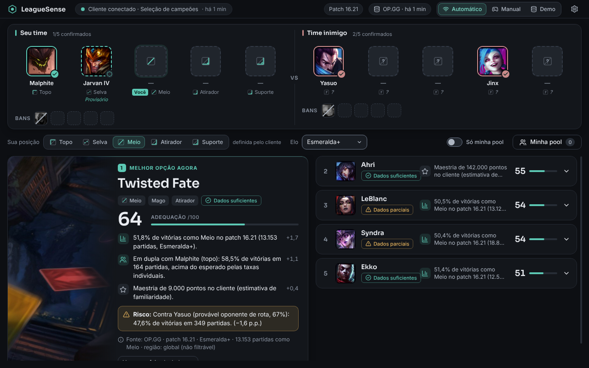
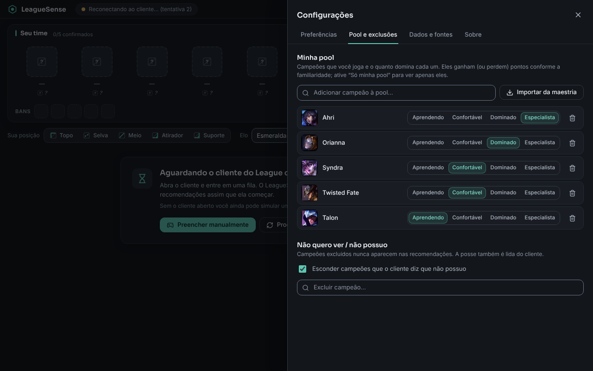

# LeagueSense

Assistente de draft de **League of Legends** para Windows: acompanha picks e bans durante a seleção de campeões e
sugere até **cinco** campeões para a sua posição, **explicando** cada sugestão (motivos, risco, fonte, patch e tamanho
da amostra). Interface em português (Brasil), tema escuro, uso pessoal em Summoner's Rift / ranked solo-duo.
**A decisão é sempre sua**: o app não escolhe, bane nem automatiza nada.

| Em ação (Electron real, dados reais do OP.GG/Data Dragon, LCU simulado) | Configurações |
|---|---|
|  |  |

> As duas capturas acima são do app **rodando de verdade** (Electron sob Xvfb): dados reais do OP.GG e do Data Dragon;
> o cliente do jogo foi **simulado** por um LCU falso — veja *Limitações reais*. Outras capturas, feitas no navegador com
> o simulador da ponte (dados fictícios): [API indisponível](docs/img/api-indisponivel.png),
> [janela mínima 960×620](docs/img/janela-minima-960x620.png), [cliente conectado fora do draft](docs/img/cliente-conectado.png).

## Estado da verificação (leia antes de confiar)

| Item | Situação |
|---|---|
| Motor, dados, LCU (protocolo), cache, falhas, respostas fora de ordem | **123 testes automatizados passando** (`npm test`) |
| Data Dragon e OP.GG MCP | **testados ao vivo** (rede): **173/173 campeões resolvem, 0 falhas**; formato dos dados conferido (`npm run check:data`) |
| Interface (layout, teclado, estados, escala 100–200 %, movimento reduzido, reordenação, textos longos) | **verificada em Chromium** (33 verificações) e **no Electron real** (11, incluindo CSP e dados reais), com capturas |
| Acessibilidade | **axe-core: 0 violações** em 8 estados (não substitui teste com leitor de tela) |
| Pacote Windows | `.zip` gerado e `app.asar` **iniciado no Electron/Linux**; o `.exe` **não foi executado no Windows** (não há Windows aqui) |
| **Cliente real do LoL (LCU)** | ❌ **NÃO testado.** Implementado conforme a documentação da comunidade e os tipos gerados do cliente; verificado contra um LCU falso |
| Instalador NSIS | Não gerado aqui (precisa de Wine no Linux). Gere no Windows ou pelo workflow `.github/workflows/build-windows.yml` |

## Instalação e execução

Requisitos: **Node.js 22+** e npm.

```bash
npm ci
npm run dev          # app em modo desenvolvimento (Electron)
npm test             # testes unitários e de integração
npm run typecheck
```

Sem chave de API, conta ou configuração: o app abre, mostra "Aguardando o cliente" e já permite **modo manual** e
**demonstração** (dados **fictícios**, claramente identificados).

### Gerar o pacote para Windows

* **No Windows:** `npm ci && npm run dist:win` → `release/LeagueSense-<versão>-x64.exe` (instalador NSIS), versão
  portátil e `.zip`.
* **Pelo GitHub Actions:** rode o workflow *Build Windows* (manual ou por tag `v*`); os arquivos saem como artefato.
* **No Linux/macOS** (sem Wine): `npm run dist:win:linux` → `release/LeagueSense-<versão>-x64.zip` (extraia e execute
  `LeagueSense.exe`). Nesse caso o `.exe` fica sem ícone/metadados.

O pacote **não é assinado**: o SmartScreen avisará "editor desconhecido". Para assinar, defina o certificado do
`electron-builder` (`CSC_LINK`/`CSC_KEY_PASSWORD`) no CI.

## Credenciais

**Nenhuma é necessária.** Data Dragon e OP.GG MCP são públicos; o LCU usa o token que o próprio cliente em execução
gera (lido localmente, mantido só em memória, nunca registrado). Nada de segredo vai no código, no front-end ou no
instalador. Variáveis de ambiente existem só para desenvolvimento/verificação (ignoradas no app empacotado):
`LEAGUESENSE_USER_DATA`, `LEAGUESENSE_LCU_DIR`, `LEAGUESENSE_FAULT=opgg|ddragon|all`.

Se um dia for preciso a Riot API (ex.: Match-V5), a menor solução segura é o usuário colar sua **chave pessoal** nas
configurações, guardada com `safeStorage`; uma chave de produção exigiria um proxy no servidor (a Riot proíbe chaves em
binários distribuídos).

## Como usar

1. Abra o app. Com o cliente do LoL aberto, ele se conecta sozinho (indicador no topo) e, ao começar a seleção de
   campeões, mostra o draft e as recomendações. Sua posição vem do cliente (ou escolha na barra de controles).
2. **Modo Manual:** clique em qualquer espaço do draft para escolher/corrigir (confirmado ou provisório, posição,
   "sou eu"). Funciona sem o cliente.
3. **Pool e preferências** (engrenagem): sua pool com familiaridade, exclusões, peso do conforto, região, animações.
   "Só minha pool" restringe a lista. Tudo é salvo localmente (`settings.json`).
4. Clique em uma recomendação para ver **como a pontuação foi calculada**. "Adequação" é uma régua relativa
   (**não** é chance de vitória).

## Fontes de dados e limites

Veja [docs/INTEGRACOES.md](docs/INTEGRACOES.md). Em resumo:

* **Data Dragon** (oficial): campeões, nomes pt-BR, imagens.
* **OP.GG MCP** (terceiros, **sem termos publicados**): taxas, confrontos, sinergias, patch. Pode mudar/limitar.
  **Não filtra por região** e confrontos/sinergias não aceitam filtro de elo.
* **LCU** (**não oficial**): draft, posse e maestria, locais. A Riot pede que o uso seja registrado no Developer Portal.

Documentos: [integrações](docs/INTEGRACOES.md) · [arquitetura](docs/ARQUITETURA.md) · [motor de recomendação](docs/RECOMENDACAO.md) · [direção visual](docs/DIRECAO-VISUAL.md).

## Limitações reais

* **O cliente real do LoL nunca foi testado.** O formato de `actions[]` (esquema `unknown[]` no cliente) vem da
  comunidade. O normalizador é tolerante, mas só um teste real confirma. Se algo não aparecer, use o modo manual.
* Região **não** filtra estatísticas; sinergias vêm só dos 10 melhores parceiros; pesos do motor **não calibrados**.
* Instalador no Windows e comportamento da barra de título (controles nativos sobrepostos) **não verificados** no Windows.
* A carga inicial de confrontos leva ~20–40 s (≤ 3 consultas simultâneas, ~2,5 s cada); depois fica em cache por 12 h.
* O serviço do OP.GG não tem SLA nem termos publicados; se mudar, o app degrada (cache → composição/pool → aviso).
* **Ação sua:** registrar o produto no [Developer Portal](https://developer.riotgames.com) e anotar o uso do LCU.

## Aviso legal

LeagueSense isn't endorsed by Riot Games and doesn't reflect the views or opinions of Riot Games or anyone officially
involved in producing or managing Riot Games properties. Riot Games, and all associated properties are trademarks or
registered trademarks of Riot Games, Inc. (texto também em *Configurações → Sobre*). Imagens vêm do Data Dragon em
tempo de execução; atributos de campeões derivam de dados do Meraki Analytics (MIT) e do Data Dragon. Fontes: Inter e
Sora (SIL OFL).

## Verificações disponíveis

| Comando | O que faz |
|---|---|
| `npm test` | 123 testes (Vitest) |
| `npm run dev:web` + `npm run verify:visual` | 33 verificações de interface em Chromium + capturas em `screenshots/` |
| `npx tsx scripts/verify-a11y.ts` | axe-core nos estados principais |
| `xvfb-run -a npx tsx scripts/electron-smoke.ts` | Electron real + LCU falso + dados reais |
| `npm run check:data` | todos os campeões resolvem no OP.GG (rede) |
| `npm run check:contrast` | contraste WCAG dos tokens |
| `xvfb-run -a npm run verify:package` | inicia o `app.asar` empacotado |
