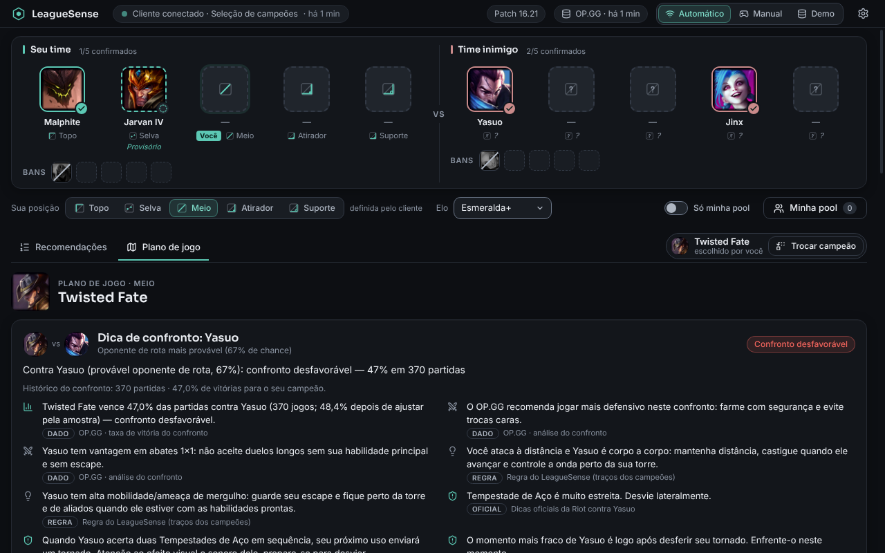
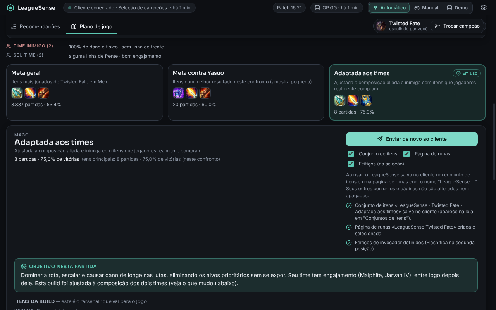

# LeagueSense

Assistente de draft de **League of Legends** para Windows: acompanha picks e bans durante a seleção de campeões e
sugere até **cinco** campeões para a sua posição, **explicando** cada sugestão (motivos, risco, fonte, patch e tamanho
da amostra) e **por que o primeiro está no topo**. Depois de escolher o campeão (pelo próprio app, se quiser), monta um
**plano de jogo**: dica de confronto para o inimigo de rota mais provável, **3 builds** feitas a partir dos dois times
(com objetivo e comportamento) e, ao clicar em **"Usar esta build"**, envia ao cliente um **conjunto de itens** e uma
**página de runas**. Interface em português (Brasil), tema escuro, uso pessoal em Summoner's Rift / ranked solo-duo.
**A decisão é sempre sua**: o app não escolhe, bane, aceita partida nem automatiza o draft.

| Recomendações e "Por que está em 1º" | Plano de jogo (dica de confronto + 3 builds) |
|---|---|
|  |  |

| Build enviada ao cliente (resultado por etapa) | Configurações |
|---|---|
|  |  |

> As capturas acima são do app **rodando de verdade** (Electron sob Xvfb): dados reais do OP.GG e do Data Dragon;
> o cliente do jogo foi **simulado** por um LCU falso — veja *Limitações reais*. Outras capturas, feitas no navegador com
> o simulador da ponte (dados fictícios): [API indisponível](docs/img/api-indisponivel.png),
> [janela mínima 960×620](docs/img/janela-minima-960x620.png), [cliente conectado fora do draft](docs/img/cliente-conectado.png).

## Estado da verificação (leia antes de confiar)

| Item | Situação |
|---|---|
| Motor, builds, dados, LCU (leitura e escrita), cache, falhas, respostas fora de ordem | **197 testes automatizados passando** (`npm test`) |
| Data Dragon e OP.GG MCP | **testados ao vivo** (rede): **173/173 campeões resolvem, 0 falhas**; formato dos dados conferido (`npm run check:data`) |
| Interface (layout, teclado, estados, escala 100–200 %, movimento reduzido, reordenação, textos longos, plano de jogo, envio) | **verificada em Chromium** (63 verificações) e **no Electron real** (21, incluindo CSP, dados reais, 3 builds e envio ao LCU falso), com capturas |
| Acessibilidade | **axe-core: 0 violações** em 14 estados (não substitui teste com leitor de tela) |
| Pacote Windows | `.zip` gerado e `app.asar` **iniciado no Electron/Linux**; o `.exe` **não foi executado no Windows** (não há Windows aqui) |
| **Cliente real do LoL (LCU)** | ❌ **NÃO testado** — nem a leitura do draft, **nem o envio de itens/runas/feitiços**. Implementado conforme a documentação da comunidade e os tipos gerados do cliente; verificado contra um LCU falso |
| Builds, objetivo e comportamento | Itens, runas e confrontos são **dados reais** (OP.GG); a adaptação aos times e o texto de objetivo/comportamento são **regras** (heurísticas), não estatística — a tela diz isso |
| Instalador NSIS | Não gerado aqui (precisa de Wine no Linux). Gere no Windows ou pelo workflow `.github/workflows/build-windows.yml` |

## Instalação e execução

Requisitos: **Node.js 22+** e npm.

```bash
npm ci
npm run dev          # app em modo desenvolvimento (Electron)
npm test             # testes unitários e de integração
npm run typecheck
```

Sem chave de API, conta ou configuração: o app abre, mostra "Aguardando o cliente" e já permite **modo manual** e
**demonstração** (dados **fictícios**, claramente identificados).

### Gerar o pacote para Windows

* **No Windows:** `npm ci && npm run dist:win` → `release/LeagueSense-<versão>-x64.exe` (instalador NSIS), versão
  portátil e `.zip`.
* **Pelo GitHub Actions:** rode o workflow *Build Windows* (manual ou por tag `v*`); os arquivos saem como artefato.
* **No Linux/macOS** (sem Wine): `npm run dist:win:linux` → `release/LeagueSense-<versão>-x64.zip` (extraia e execute
  `LeagueSense.exe`). Nesse caso o `.exe` fica sem ícone/metadados.

O pacote **não é assinado**: o SmartScreen avisará "editor desconhecido". Para assinar, defina o certificado do
`electron-builder` (`CSC_LINK`/`CSC_KEY_PASSWORD`) no CI.

## Credenciais

**Nenhuma é necessária.** Data Dragon e OP.GG MCP são públicos; o LCU usa o token que o próprio cliente em execução
gera (lido localmente, mantido só em memória, nunca registrado). Nada de segredo vai no código, no front-end ou no
instalador. Variáveis de ambiente existem só para desenvolvimento/verificação (ignoradas no app empacotado):
`LEAGUESENSE_USER_DATA`, `LEAGUESENSE_LCU_DIR`, `LEAGUESENSE_FAULT=opgg|ddragon|all`.

Se um dia for preciso a Riot API (ex.: Match-V5), a menor solução segura é o usuário colar sua **chave pessoal** nas
configurações, guardada com `safeStorage`; uma chave de produção exigiria um proxy no servidor (a Riot proíbe chaves em
binários distribuídos).

## Como usar

1. Abra o app. Com o cliente do LoL aberto, ele se conecta sozinho (indicador no topo) e, ao começar a seleção de
   campeões, mostra o draft e as recomendações. Sua posição vem do cliente (ou escolha na barra de controles).
2. **Modo Manual:** clique em qualquer espaço do draft para escolher/corrigir (confirmado ou provisório, posição,
   "sou eu"). Funciona sem o cliente.
3. **Pool e preferências** (engrenagem): sua pool com familiaridade, exclusões, peso do conforto, região, animações.
   "Só minha pool" restringe a lista. Tudo é salvo localmente (`settings.json`).
4. Clique em uma recomendação para ver **como a pontuação foi calculada**. "Adequação" é uma régua relativa
   (**não** é chance de vitória). O destaque traz **"Por que está em 1º"** (comparação com o 2º, fator a fator).
5. **Escolher o seu campeão:** "Escolher e ver plano de jogo" (no destaque ou ao expandir uma opção) ou, na aba
   **Plano de jogo**, "Trocar campeão" (busca por nome e posição). Isso escolhe **só no LeagueSense**; o que você
   travar no cliente tem prioridade.
6. **Plano de jogo:** dica para o inimigo de rota mais provável (cada linha diz se é dado, regra, dica oficial ou de
   terceiros), resumo dos times e **3 builds** — *Meta geral*, *Meta no confronto* e *Adaptada aos times* — com itens
   (e o motivo de cada ajuste), runas, feitiços, ordem de habilidades, **objetivo na partida** e **como se comportar**
   em cada fase.
7. **"Usar esta build"** envia ao cliente (conectado) um conjunto de itens "LeagueSense · …" (o "arsenal": iniciais,
   botas, principais, situacionais, visão) e uma página de runas "LeagueSense …"; feitiços são opcionais (só na seleção
   de campeões). Seus conjuntos e páginas **nunca são alterados nem apagados**. Em modo demonstração nada é enviado.
   Detalhes: [docs/BUILDS.md](docs/BUILDS.md).

## Fontes de dados e limites

Veja [docs/INTEGRACOES.md](docs/INTEGRACOES.md). Em resumo:

* **Data Dragon** (oficial): campeões, nomes pt-BR, imagens, catálogo de itens/runas/feitiços e dicas da Riot para enfrentar cada campeão.
* **OP.GG MCP** (terceiros, **sem termos publicados**): taxas, confrontos, sinergias, builds, patch. Pode mudar/limitar.
  **Não filtra por região** e confrontos/sinergias/guia de confronto não aceitam filtro de elo. A dica de confronto do
  OP.GG só existe **em inglês** (mostrada como tal, sem tradução).
* **LCU** (**não oficial**): draft, posse e maestria (leitura) e, só quando você usa uma build, escrita restrita a
  conjuntos de itens, página de runas e feitiços. A Riot pede que o uso seja registrado no Developer Portal.

Documentos: [integrações](docs/INTEGRACOES.md) · [arquitetura](docs/ARQUITETURA.md) · [motor de recomendação](docs/RECOMENDACAO.md) · [plano de jogo e builds](docs/BUILDS.md) · [direção visual](docs/DIRECAO-VISUAL.md).

## Limitações reais

* **O cliente real do LoL nunca foi testado.** O formato de `actions[]` (esquema `unknown[]` no cliente) vem da
  comunidade. O normalizador é tolerante, mas só um teste real confirma. Se algo não aparecer, use o modo manual.
  O mesmo vale para o **envio da build** (itens, runas, feitiços): validado contra um cliente simulado; se o cliente
  recusar uma etapa, o app mostra qual e por quê, e o resto segue. Se não houver espaço para a página de runas, o app
  **não apaga** nenhuma página sua — peça que você libere uma.
* Builds e dica de confronto precisam de rede na primeira consulta (cache depois: builds 6 h, confrontos 12 h). Objetivo
  e comportamento são **regras**, não estatística; amostras de itens por confronto são pequenas (o app mostra o tamanho).
  O oponente de rota é uma **inferência** (a tela mostra a probabilidade).
* Região **não** filtra estatísticas; sinergias vêm só dos 10 melhores parceiros; pesos do motor **não calibrados**.
* Instalador no Windows e comportamento da barra de título (controles nativos sobrepostos) **não verificados** no Windows.
* A carga inicial de confrontos leva ~20–40 s (≤ 3 consultas simultâneas, ~2,5 s cada); depois fica em cache por 12 h.
* O serviço do OP.GG não tem SLA nem termos publicados; se mudar, o app degrada (cache → composição/pool → aviso).
* **Ação sua:** registrar o produto no [Developer Portal](https://developer.riotgames.com) e anotar o uso do LCU.

## Aviso legal

LeagueSense isn't endorsed by Riot Games and doesn't reflect the views or opinions of Riot Games or anyone officially
involved in producing or managing Riot Games properties. Riot Games, and all associated properties are trademarks or
registered trademarks of Riot Games, Inc. (texto também em *Configurações → Sobre*). Imagens vêm do Data Dragon em
tempo de execução; atributos de campeões derivam de dados do Meraki Analytics (MIT) e do Data Dragon. Fontes: Inter e
Sora (SIL OFL).

## Verificações disponíveis

| Comando | O que faz |
|---|---|
| `npm test` | 197 testes (Vitest) |
| `npm run dev:web` + `npm run verify:visual` | 63 verificações de interface em Chromium + capturas em `screenshots/` |
| `npx tsx scripts/verify-a11y.ts` | axe-core nos estados principais |
| `xvfb-run -a npx tsx scripts/electron-smoke.ts` | Electron real + LCU falso + dados reais |
| `npm run check:data` | todos os campeões resolvem no OP.GG (rede) |
| `npm run check:contrast` | contraste WCAG dos tokens |
| `xvfb-run -a npm run verify:package` | inicia o `app.asar` empacotado |
